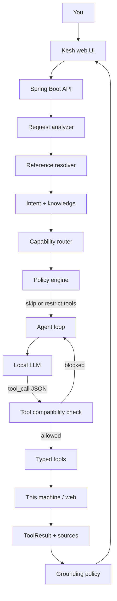
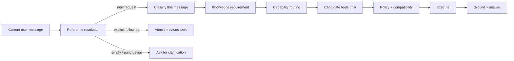
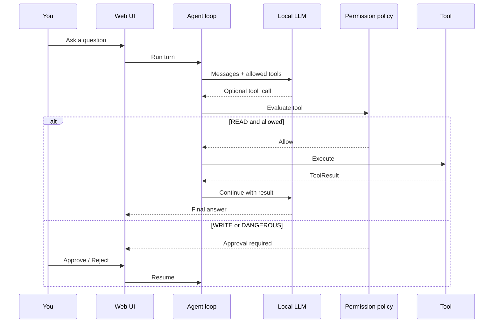
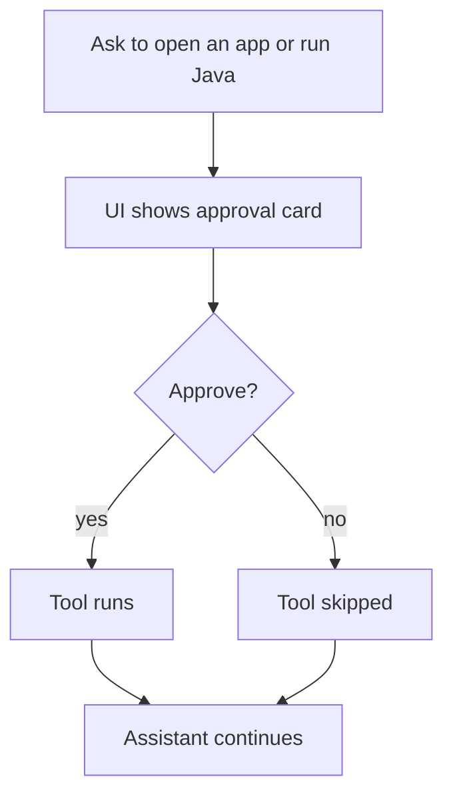

# Kesh

**Local-first AI work assistant for your machine.**

Kesh is a Spring Boot agent with a small web UI. You talk in plain language. A local model (Gemma / Ollama) may *request* tools. **Spring Boot is the only process allowed to touch the filesystem, apps, terminal, or the network.** The model never gets a shell.

[](#prerequisites)
[](#prerequisites)
[](LICENSE)

---

## Why Kesh?

Most “AI assistants” either:

1. send everything to a cloud API, or  
2. let the model run shell commands with weak guardrails.

Kesh does neither by default.

| Goal | How Kesh does it |
| --- | --- |
| Private by default | Local models (Docker Model Runner or Ollama) |
| Safe actions | Typed tools + permission policy + human approval for writes |
| Correct routing | Intent → knowledge need → capability → candidate tools → execute |
| Grounded answers | Live facts must come from tool results, not guesses |
| Work + Personal desks | Separate chat history; shared tools with path allowlists |

Think of Kesh as a careful office assistant who is **not** allowed to open drawers themselves. They fill out a form; Spring Boot decides whether the form is allowed.

---

## Features

- **Chat** — explanations, comparisons, coding help (no tools when not needed)
- **Web search / fetch / crawl** — current news, weather, traffic, stock quotes (policy-gated)
- **Filesystem** — list / read / search under allowlisted paths only
- **macOS apps** — open / focus / quit (approval for writes)
- **Runtime inspect** — Java, Cursor, macOS versions on this machine
- **Sandboxed Java snippets** — run short Java in Docker/Podman (approval required)
- **Writing intelligence** — format, shorten, summarize, rewrite with LanguageTool polish
- **Optional work apps** — Slack, Jira, Confluence, Gmail, GitHub (off until you configure tokens)
- **Learning loop** — local interaction logs + feedback candidates (never auto-trains without approval)

---

## Architecture (high level)



### Request pipeline (every turn)



### Permission model



---

## Prerequisites

- **Java 21**
- **Maven 3.9+**
- **macOS** for application tools (`open`, `osascript`)
- A local model runtime:
  - **Docker Desktop Model Runner** with `gemma3` (default), or
  - **Ollama** with a pulled model

No cloud AI API is required for core chat. Optional integrations use your own tokens.

---

## Quick start

```bash
git clone https://github.com/udayjadhav/kesh.git
cd kesh

# Option A — Docker Model Runner (default)
# Ensure Docker Desktop Model Runner is on, then:
./scripts/run.sh

# Option B — Ollama
# ollama pull gemma3
# mvn spring-boot:run -Dspring-boot.run.profiles=ollama
```

Open **http://localhost:8080**

Work desk and Personal desk share tools; chat history stays isolated.

---

## How to use (day to day)

### 1. Pick a desk

| Desk | Intended use |
| --- | --- |
| **Work** | Projects, Jira/Slack/GitHub when configured |
| **Personal** | Personal docs under personal path allowlist |

### 2. Ask normally

Examples that stay **local / chat** (no tools):

- `what is CAP theorem`
- `inner join vs outer join`
- `compare Java and Clojure`

Examples that need **current public data** (web search):

- `weather today in Pune`
- `Apple stock price`
- `latest AI news`
- `traffic from A to B now`

Examples that need **machine tools**:

- `which Java version is installed?`
- `read README.md in ~/Kesh`
- `open Google Chrome` (asks for approval)

Examples that need **Java sandbox**:

- `run this Java code` / `execute this Java snippet`

### 3. Follow-ups that keep context

| You say | What Kesh does |
| --- | --- |
| `summarize above` | Rewrites previous answer (no new search) |
| `check again` | Fresh lookup of the previous live topic |
| `how many …?` after a live topic | Retrieves again; does not treat prior guess as fact |
| `source?` | Runs source verification / search |
| A new short topic (e.g. company name) | Independent request — previous topic does not leak |

### 4. Approvals

When a tool is WRITE or DANGEROUS, the UI shows **Approve / Reject**. Nothing runs until you decide.

### 5. Sources

Successful web tools attach sources in the UI. Kesh should not invent URLs. Live numbers should appear only if they exist in a tool result.

---

## Use cases

### A. Private coding companion

Ask design and code questions against a local model. Files stay on your allowlist. Terminal stays off unless you enable it.

### B. Live research without cloud chat history

Weather, traffic, news, market quotes go through web tools with SSRF guards and rate limits. Answers can cite retrieved sources.

### C. Safe “do something on my Mac”

Open apps, inspect runtimes, read project files — with path allowlists, symlink protection, and approvals for side effects.

### D. Writing cleanup

Paste a draft → ask to format / shorten / make professional. LanguageTool runs locally; optional LLM polish keeps meaning and names.

### E. Optional company stack

Turn on Slack / Jira / Confluence / Gmail / GitHub only when you set env vars. Until then, Kesh explains that the app is not connected — it does not fake data.

---

## Configuration

Primary file: `src/main/resources/application.yml`

| Area | Key settings |
| --- | --- |
| LLM | `kesh.llm.provider`, `base-url`, `model` |
| Filesystem | `kesh.filesystem.allowed-paths`, `personal-paths` |
| Terminal | `kesh.terminal.enabled` (default **false**) |
| Web | `kesh.web.enabled`, search/fetch/crawl |
| Java sandbox | `kesh.java-execution.*` |
| Integrations | `kesh.integrations.*` (all off by default) |
| Debug | `kesh.debug.enabled` or `KESH_DEBUG=true` |

Copy `.env.example` → `.env` for tokens. **Never commit `.env`.**

### Switch to Ollama

```bash
mvn spring-boot:run -Dspring-boot.run.profiles=ollama
```

See `src/main/resources/application-ollama.yml`.

---

## Project layout

```text
kesh/
├── pom.xml
├── scripts/run.sh                 # start helper
├── scripts/generate_kesh_intents.py
├── data/                          # dataset notes + copies
├── src/main/java/com/kesh/
│   ├── agent/                     # loop, orchestrator, conversations
│   ├── nlp/                       # classify, knowledge, follow-ups
│   ├── routing/                   # capability plan + tool compatibility
│   ├── tools/                     # filesystem, web, apps, integrations
│   ├── security/                  # permissions, paths, approvals
│   ├── writing/                   # writing pipeline
│   ├── llm/                       # clients, transcript, tool parser
│   └── eval/                      # answer judge + grounding
├── src/main/resources/
│   ├── application.yml
│   ├── nlp/                       # OpenNLP training utterances
│   ├── prompts/
│   └── templates/                 # Thymeleaf UI
└── src/test/java/                 # routing, security, agent tests
```

---

## Security model (non-negotiable)

- Path allowlists + canonicalization (`toRealPath`) — no `../` escapes, no symlink escapes
- Terminal disabled by default; command allowlist when enabled
- Java snippets run in an isolated container (no network, no host files)
- SSRF protection on web fetch/crawl
- Work vs Personal desk history isolation
- LLM is **not** the authorization layer — policy + compatibility decide
- Destructive / write tools require human approval

---

## Development

```bash
# Run tests
mvn test

# Run app
./scripts/run.sh

# Regenerate intent training data (optional)
python3 scripts/generate_kesh_intents.py
```

Routing architecture tests live in `src/test/java/com/kesh/nlp/RoutingArchitectureTest.java` — categories such as static knowledge, market quotes, current information, contamination, and Java-only execution.

---

## UI flows

### Main chat turn

```mermaid
flowchart TD
    start([Open http://localhost:8080]) --> desk{Work or Personal?}
    desk --> type[Type a message]
    type --> send[Send]
    send --> think[Thinking / tools]
    think --> answer[Answer + optional sources]
    answer --> more{Another question?}
    more -->|yes| type
    more -->|no| end([Done])
```

### Approval turn



---

## Roadmap ideas

- Richer multi-model routing UI
- Packed knowledge packs under `~/.kesh/knowledge`
- Optional cloud providers behind the same tool policy
- Windows / Linux app control ports

Contributions and issues welcome on GitHub.

---

## License

[MIT](LICENSE) © 2026 Uday Jadhav

---

## Credits

Built as a local-first agent OS: classify → route → authorize → execute → observe → ground → respond.
